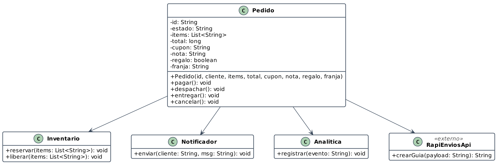

# Caso 01. Comercio electrónico: ciclo de vida de los pedidos

**Dominio:** Comercio electrónico y logística  
**Código inicial:** [`src/main/java/edu/ingsoft/actividad/comportamiento/caso01/`](../../src/main/java/edu/ingsoft/actividad/comportamiento/caso01/)

## 1. Contexto de la aplicación

«TiendaVerde» vende productos orgánicos a domicilio. Un pedido pasa por los estados CREADO, PAGADO, DESPACHADO, ENTREGADO y CANCELADO, y lo que se puede hacer con él depende del estado en que se encuentra (por ejemplo, un pedido despachado ya no puede cancelarse).

Cuando un pedido cambia de estado deben reaccionar varias áreas: inventario, notificaciones al cliente, analítica y el programa de puntos. Los despachos se hacen con una transportadora externa cuyo cliente API usa sus propios formatos. Un pedido tiene muchos datos opcionales: cupón, nota, empaque de regalo, franja de entrega.

## 2. Problemática

La clase Pedido guarda su estado como String y cada operación contiene un switch con las reglas de transición. Al final de cada transición, Pedido llama directamente a Inventario, Notificador y Analitica, y para despachar construye el formato propio de la transportadora. Los pedidos se crean con un constructor de ocho parámetros.

### Lo que reporta el equipo de desarrollo

- «Agregar el estado DEVUELTO implica modificar los cinco métodos de Pedido.»
- «Marketing quiere que el programa de puntos reaccione a las entregas, pero eso obliga a tocar Pedido otra vez.»
- «Se pudo cancelar un pedido despachado porque un case del switch quedó mal.»
- «Si cambiamos de transportadora hay que reescribir el método despachar.»

## 3. Diagrama de clases inicial



> Fuente editable: [`diagrama-inicial.puml`](diagrama-inicial.puml) (PlantUML).

## 4. Código inicial

| Archivo | Ubicación |
|---|---|
| `Inventario.java` | [`src/main/java/edu/ingsoft/actividad/comportamiento/caso01/Inventario.java`](../../src/main/java/edu/ingsoft/actividad/comportamiento/caso01/Inventario.java) |
| `Notificador.java` | [`src/main/java/edu/ingsoft/actividad/comportamiento/caso01/Notificador.java`](../../src/main/java/edu/ingsoft/actividad/comportamiento/caso01/Notificador.java) |
| `Analitica.java` | [`src/main/java/edu/ingsoft/actividad/comportamiento/caso01/Analitica.java`](../../src/main/java/edu/ingsoft/actividad/comportamiento/caso01/Analitica.java) |
| `RapiEnviosApi.java` | [`src/main/java/edu/ingsoft/actividad/comportamiento/caso01/RapiEnviosApi.java`](../../src/main/java/edu/ingsoft/actividad/comportamiento/caso01/RapiEnviosApi.java) |
| `Pedido.java` | [`src/main/java/edu/ingsoft/actividad/comportamiento/caso01/Pedido.java`](../../src/main/java/edu/ingsoft/actividad/comportamiento/caso01/Pedido.java) |
| `Demo.java` | [`src/main/java/edu/ingsoft/actividad/comportamiento/caso01/Demo.java`](../../src/main/java/edu/ingsoft/actividad/comportamiento/caso01/Demo.java) |

Ejecutar el escenario actual:

```bash
scripts/ejecutar.sh caso01
```

Salida actual (también en [`salida-esperada.txt`](salida-esperada.txt)):

```text
P-001:
  No se puede despachar en estado CREADO
  [inventario] reserva [café, miel]
  [notificación a ana] Pago recibido por $54000
  [analítica] P-001 PAGADO
  [notificación a ana] Pedido en camino, guía RAPI-39662 (empaque de regalo)
  [analítica] P-001 DESPACHADO
  [notificación a ana] Pedido entregado en franja tarde
  [analítica] P-001 ENTREGADO
  No se puede cancelar en estado ENTREGADO
  estado final: ENTREGADO
P-002:
  [inventario] reserva [quinua]
  [notificación a luis] Pago recibido por $18000
  [analítica] P-002 PAGADO
  [notificación a luis] Pedido en camino, guía RAPI-39229
  [analítica] P-002 DESPACHADO
  [inventario] libera [quinua]
  [notificación a luis] Pedido cancelado; se reembolsarán $18000
  [analítica] P-002 CANCELADO
  estado final: CANCELADO
```

## 5. Nuevos requerimientos del negocio

Después de refactorizar, el diseño debe permitir incorporar los siguientes cambios. Impleméntelos y demuéstrelos en una clase `DemoNuevosRequerimientos`:

1. Agregar el estado DEVUELTO (solo desde ENTREGADO, dentro de los 5 días) sin modificar las clases de los demás estados.
2. Permitir que el programa de puntos y cualquier otra área se suscriban a los cambios de estado sin modificar Pedido.
3. Cambiar de transportadora (RapiEnvíos → EnvíaYa) sin modificar la lógica del pedido.
4. Crear pedidos con valores por defecto (sin cupón, sin regalo, franja «mañana») y validar que tengan al menos un ítem.

## 6. Preguntas orientadoras

1. ¿Qué cambia en el comportamiento de un pedido según su estado? ¿Quién debería decidir la transición?
2. ¿Por qué Pedido debería o no conocer a Inventario, Notificador y Analitica?
3. ¿Qué interfaz necesitaría el dominio para despachar, independientemente de la transportadora?
4. ¿Cómo crearía un pedido válido con muchos datos opcionales?

## 7. Entregables del caso

1. Informe `casos/caso-01-ciclo-de-vida-pedidos/INFORME.md` diligenciado a partir de [`PLANTILLA_INFORME.md`](../../PLANTILLA_INFORME.md).
2. Diagrama de clases de la solución en `casos/caso-01-ciclo-de-vida-pedidos/diagrama-solucion.puml` (y su PNG).
3. Código refactorizado en el paquete `edu.ingsoft.actividad.comportamiento.caso01.solucion`, conservando el comportamiento correcto de `Demo` (verificable con `scripts/verificar.sh`; documente las diferencias que se deban a defectos corregidos).
4. Clase `DemoNuevosRequerimientos` que evidencie los cambios de la sección 5.

[← Volver a la actividad](../../README.md)
