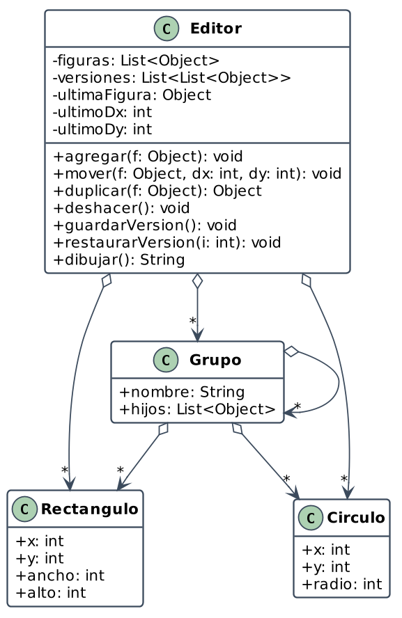

# Caso 02. Editor de diagramas para clases virtuales

**Dominio:** Herramientas educativas colaborativas  
**Código inicial:** [`src/main/java/edu/ingsoft/actividad/comportamiento/caso02/`](../../src/main/java/edu/ingsoft/actividad/comportamiento/caso02/)

## 1. Contexto de la aplicación

«PizarraViva» es un editor en línea donde docentes y estudiantes dibujan diagramas durante las clases virtuales. Los diagramas tienen figuras simples (rectángulos, círculos, textos) y grupos de figuras que se mueven y se duplican como una unidad; un grupo puede contener otros grupos.

Los usuarios esperan deshacer y rehacer cualquier acción, guardar «versiones» del tablero para volver a ellas y duplicar figuras o grupos completos. El docente quiere además grabar secuencias de acciones (macros) para repetirlas en otras clases.

## 2. Problemática

Editor maneja las figuras como Object y distingue rectángulos, círculos y grupos con instanceof en cada operación. Deshacer solo funciona para «mover» porque el editor guarda la última posición en un campo; no hay rehacer ni macros. Para guardar versiones, el editor copia las listas de figuras de forma superficial, y al duplicar un grupo el duplicado comparte las figuras con el original.

### Lo que reporta el equipo de desarrollo

- «Deshacer después de duplicar no hace nada.»
- «Al mover un grupo duplicado también se movía el original.»
- «Restaurar una versión guardada devolvía el tablero modificado, no el de ese momento.»
- «Cada operación nueva (rotar, cambiar color) requiere otra cadena de instanceof.»

## 3. Diagrama de clases inicial



> Fuente editable: [`diagrama-inicial.puml`](diagrama-inicial.puml) (PlantUML).

## 4. Código inicial

| Archivo | Ubicación |
|---|---|
| `Rectangulo.java` | [`src/main/java/edu/ingsoft/actividad/comportamiento/caso02/Rectangulo.java`](../../src/main/java/edu/ingsoft/actividad/comportamiento/caso02/Rectangulo.java) |
| `Circulo.java` | [`src/main/java/edu/ingsoft/actividad/comportamiento/caso02/Circulo.java`](../../src/main/java/edu/ingsoft/actividad/comportamiento/caso02/Circulo.java) |
| `Grupo.java` | [`src/main/java/edu/ingsoft/actividad/comportamiento/caso02/Grupo.java`](../../src/main/java/edu/ingsoft/actividad/comportamiento/caso02/Grupo.java) |
| `Editor.java` | [`src/main/java/edu/ingsoft/actividad/comportamiento/caso02/Editor.java`](../../src/main/java/edu/ingsoft/actividad/comportamiento/caso02/Editor.java) |
| `Demo.java` | [`src/main/java/edu/ingsoft/actividad/comportamiento/caso02/Demo.java`](../../src/main/java/edu/ingsoft/actividad/comportamiento/caso02/Demo.java) |

Ejecutar el escenario actual:

```bash
scripts/ejecutar.sh caso02
```

Salida actual (también en [`salida-esperada.txt`](salida-esperada.txt)):

```text
Inicial:           [Logo[Rect(0,0), Circ(25,10)], Circ(100,100)]
Duplicar y mover:  [Logo[Rect(200,0), Circ(225,10)], Circ(100,100), Logo-copia[Rect(200,0), Circ(225,10)]]
Deshacer x2:       [Logo[Rect(0,0), Circ(25,10)], Circ(100,100), Logo-copia[Rect(0,0), Circ(25,10)]]
Restaurar v0:      [Logo[Rect(0,0), Circ(25,10)], Circ(100,100)]
```

## 5. Nuevos requerimientos del negocio

Después de refactorizar, el diseño debe permitir incorporar los siguientes cambios. Impleméntelos y demuéstrelos en una clase `DemoNuevosRequerimientos`:

1. Deshacer y rehacer ilimitado para mover, agregar, duplicar y cambiar color.
2. Guardar y restaurar versiones del tablero sin exponer la estructura interna del editor.
3. Duplicar figuras y grupos anidados de forma independiente del original.
4. Grabar una macro (secuencia de acciones) y aplicarla de nuevo; deshacer la macro debe revertir todos sus pasos.

## 6. Preguntas orientadoras

1. ¿Qué tienen en común una figura simple y un grupo desde el punto de vista del editor?
2. ¿Cómo representaría una acción del usuario para poder deshacerla, rehacerla y repetirla?
3. ¿Qué diferencia hay entre guardar las acciones y guardar el estado completo del tablero? ¿Cuándo conviene cada una?
4. ¿Qué debe copiarse al duplicar un grupo que contiene otros grupos?

## 7. Entregables del caso

1. Informe `casos/caso-02-editor-diagramas/INFORME.md` diligenciado a partir de [`PLANTILLA_INFORME.md`](../../PLANTILLA_INFORME.md).
2. Diagrama de clases de la solución en `casos/caso-02-editor-diagramas/diagrama-solucion.puml` (y su PNG).
3. Código refactorizado en el paquete `edu.ingsoft.actividad.comportamiento.caso02.solucion`, conservando el comportamiento correcto de `Demo` (verificable con `scripts/verificar.sh`; documente las diferencias que se deban a defectos corregidos).
4. Clase `DemoNuevosRequerimientos` que evidencie los cambios de la sección 5.

[← Volver a la actividad](../../README.md)
