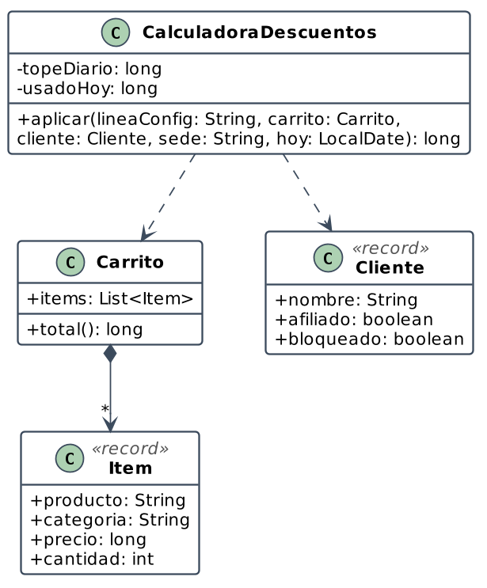

# Caso 03. Supermercado: motor de promociones y elegibilidad

**Dominio:** Comercio minorista  
**Código inicial:** [`src/main/java/edu/ingsoft/actividad/comportamiento/caso03/`](../../src/main/java/edu/ingsoft/actividad/comportamiento/caso03/)

## 1. Contexto de la aplicación

«SuperAhorro» tiene 40 sedes y lanza promociones cada semana: porcentaje de descuento, «lleve 3 pague 2», descuento fijo por compras superiores a un monto y precio especial para afiliados. El área de mercadeo define las promociones en un archivo de configuración con líneas como «PORCENTAJE;LACTEOS;15» o «LLEVE_PAGUE;GASEOSA;3;2».

Antes de aplicar una promoción se verifican, en orden, varias condiciones de elegibilidad: que el cliente no esté bloqueado, que la promoción esté vigente, que no se supere el tope de descuentos del día y que la sede participe. Mercadeo también quiere crear promociones combinadas («15 % en lácteos y además 3x2 en gaseosas» como una sola campaña).

## 2. Problemática

CalculadoraDescuentos contiene una cadena de if/else por tipo de promoción y, mezcladas con ella, todas las validaciones de elegibilidad en un orden fijo. Lee y analiza el archivo de configuración dentro del mismo método. No existe forma de agrupar varias promociones en una campaña.

### Lo que reporta el equipo de desarrollo

- «Cada promoción nueva implica modificar el método aplicar, que ya tiene 70 líneas.»
- «Mercadeo pidió validar la sede antes que la vigencia y no pudimos cambiar el orden sin reescribir.»
- «El tope diario se valida en el 3x2 pero se olvidó en el descuento por monto.»
- «Para una campaña combinada se duplicaron líneas en el archivo y se aplicó dos veces el mismo descuento.»

## 3. Diagrama de clases inicial



> Fuente editable: [`diagrama-inicial.puml`](diagrama-inicial.puml) (PlantUML).

## 4. Código inicial

| Archivo | Ubicación |
|---|---|
| `Item.java` | [`src/main/java/edu/ingsoft/actividad/comportamiento/caso03/Item.java`](../../src/main/java/edu/ingsoft/actividad/comportamiento/caso03/Item.java) |
| `Cliente.java` | [`src/main/java/edu/ingsoft/actividad/comportamiento/caso03/Cliente.java`](../../src/main/java/edu/ingsoft/actividad/comportamiento/caso03/Cliente.java) |
| `Carrito.java` | [`src/main/java/edu/ingsoft/actividad/comportamiento/caso03/Carrito.java`](../../src/main/java/edu/ingsoft/actividad/comportamiento/caso03/Carrito.java) |
| `CalculadoraDescuentos.java` | [`src/main/java/edu/ingsoft/actividad/comportamiento/caso03/CalculadoraDescuentos.java`](../../src/main/java/edu/ingsoft/actividad/comportamiento/caso03/CalculadoraDescuentos.java) |
| `Demo.java` | [`src/main/java/edu/ingsoft/actividad/comportamiento/caso03/Demo.java`](../../src/main/java/edu/ingsoft/actividad/comportamiento/caso03/Demo.java) |

Ejecutar el escenario actual:

```bash
scripts/ejecutar.sh caso03
```

Salida actual (también en [`salida-esperada.txt`](salida-esperada.txt)):

```text
Total carrito: $98,600
PORCENTAJE;LACTEOS;15      -> $5,880
LLEVE_PAGUE;GASEOSA;3;2    -> $12,000
POR_MONTO;80000;40000      -> $40,000
AFILIADO;5                 -> $4,930
Descuento total: $62,810 (tope diario $50,000)
```

## 5. Nuevos requerimientos del negocio

Después de refactorizar, el diseño debe permitir incorporar los siguientes cambios. Impleméntelos y demuéstrelos en una clase `DemoNuevosRequerimientos`:

1. Agregar la promoción «segunda unidad al 50 %» sin modificar las promociones existentes.
2. Permitir reordenar, agregar o quitar condiciones de elegibilidad por configuración (por ejemplo, «solo los martes»).
3. Crear campañas que agrupen varias promociones y se apliquen como una sola, con el mismo tratamiento que una promoción individual.
4. Construir las promociones a partir de las líneas del archivo en un único lugar, extensible a nuevos tipos.

## 6. Preguntas orientadoras

1. ¿Qué varía entre una promoción y otra? ¿Qué permanece igual?
2. ¿Cómo modelaría una secuencia de validaciones en la que cualquiera puede detener el proceso?
3. ¿Cómo trataría igual a una promoción individual y a una campaña de varias promociones?
4. ¿Dónde debería vivir el conocimiento del formato del archivo de configuración?

## 7. Entregables del caso

1. Informe `casos/caso-03-motor-promociones/INFORME.md` diligenciado a partir de [`PLANTILLA_INFORME.md`](../../PLANTILLA_INFORME.md).
2. Diagrama de clases de la solución en `casos/caso-03-motor-promociones/diagrama-solucion.puml` (y su PNG).
3. Código refactorizado en el paquete `edu.ingsoft.actividad.comportamiento.caso03.solucion`, conservando el comportamiento correcto de `Demo` (verificable con `scripts/verificar.sh`; documente las diferencias que se deban a defectos corregidos).
4. Clase `DemoNuevosRequerimientos` que evidencie los cambios de la sección 5.

[← Volver a la actividad](../../README.md)
