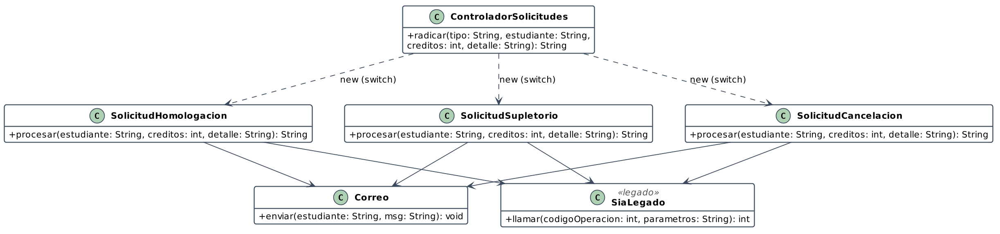

# Caso 04. Universidad: trámite de solicitudes académicas

**Dominio:** Gestión académica universitaria  
**Código inicial:** [`src/main/java/edu/ingsoft/actividad/comportamiento/caso04/`](../../src/main/java/edu/ingsoft/actividad/comportamiento/caso04/)

## 1. Contexto de la aplicación

La oficina de registro académico recibe solicitudes de homologación de asignaturas, cancelación de semestre y exámenes supletorios. Todas siguen el mismo proceso general: validar los requisitos, calcular el costo del trámite, obtener las aprobaciones necesarias, registrar el resultado en el sistema académico y notificar al estudiante. Cada tipo de solicitud tiene sus propios requisitos y costo.

Las aprobaciones dependen del número de créditos afectados: el coordinador aprueba hasta 6 créditos, el director de programa hasta 12 y el consejo de facultad por encima de 12. El registro se hace en el sistema académico institucional (SIA), un sistema heredado con una interfaz de llamadas por código de operación.

## 2. Problemática

Existe una clase por tipo de solicitud y cada una repite el proceso completo, con pequeñas diferencias de orden (la de supletorios notifica antes de registrar en el SIA). La cadena de aprobaciones está codificada con if/else en las tres clases, con umbrales distintos por error. Cada clase arma las llamadas al SIA con códigos de operación y formatos propios. El tipo de solicitud se resuelve con un switch en el controlador.

### Lo que reporta el equipo de desarrollo

- «Cambiamos el umbral del coordinador a 6 créditos en homologaciones y olvidamos las otras dos clases.»
- «Para agregar «reintegro» hay que copiar una clase de 60 líneas.»
- «El SIA va a ser reemplazado el próximo año y su código de operación aparece en todas partes.»
- «La auditoría encontró supletorios notificados como aprobados antes de quedar registrados.»

## 3. Diagrama de clases inicial



> Fuente editable: [`diagrama-inicial.puml`](diagrama-inicial.puml) (PlantUML).

## 4. Código inicial

| Archivo | Ubicación |
|---|---|
| `SiaLegado.java` | [`src/main/java/edu/ingsoft/actividad/comportamiento/caso04/SiaLegado.java`](../../src/main/java/edu/ingsoft/actividad/comportamiento/caso04/SiaLegado.java) |
| `Correo.java` | [`src/main/java/edu/ingsoft/actividad/comportamiento/caso04/Correo.java`](../../src/main/java/edu/ingsoft/actividad/comportamiento/caso04/Correo.java) |
| `SolicitudHomologacion.java` | [`src/main/java/edu/ingsoft/actividad/comportamiento/caso04/SolicitudHomologacion.java`](../../src/main/java/edu/ingsoft/actividad/comportamiento/caso04/SolicitudHomologacion.java) |
| `SolicitudCancelacion.java` | [`src/main/java/edu/ingsoft/actividad/comportamiento/caso04/SolicitudCancelacion.java`](../../src/main/java/edu/ingsoft/actividad/comportamiento/caso04/SolicitudCancelacion.java) |
| `SolicitudSupletorio.java` | [`src/main/java/edu/ingsoft/actividad/comportamiento/caso04/SolicitudSupletorio.java`](../../src/main/java/edu/ingsoft/actividad/comportamiento/caso04/SolicitudSupletorio.java) |
| `ControladorSolicitudes.java` | [`src/main/java/edu/ingsoft/actividad/comportamiento/caso04/ControladorSolicitudes.java`](../../src/main/java/edu/ingsoft/actividad/comportamiento/caso04/ControladorSolicitudes.java) |
| `Demo.java` | [`src/main/java/edu/ingsoft/actividad/comportamiento/caso04/Demo.java`](../../src/main/java/edu/ingsoft/actividad/comportamiento/caso04/Demo.java) |

Ejecutar el escenario actual:

```bash
scripts/ejecutar.sh caso04
```

Salida actual (también en [`salida-esperada.txt`](salida-esperada.txt)):

```text
  [SIA op 301] est-1001|HOM|8|certificado-uni-x.pdf
  [correo a est-1001] Homologación aprobada por Director de programa. Costo $200000
Homologación OK (Director de programa)
  [SIA op 450] CAN;est-1002;8
  [correo a est-1002] Cancelación aprobada por Coordinador. Costo $0
Cancelación OK (Coordinador)
  [correo a est-1003] Supletorio aprobado por Coordinador. Costo $60000
  [SIA op 512] est-1003/SUP/INCAPACIDAD-EPS-778
Supletorio OK (Coordinador)
Rechazada: falta el certificado de notas
Tipo de solicitud no soportado: REINTEGRO
```

## 5. Nuevos requerimientos del negocio

Después de refactorizar, el diseño debe permitir incorporar los siguientes cambios. Impleméntelos y demuéstrelos en una clase `DemoNuevosRequerimientos`:

1. Agregar el tipo de solicitud «reintegro» escribiendo solo lo que lo diferencia de los demás.
2. Garantizar el mismo orden del proceso para todas las solicitudes (registrar antes de notificar).
3. Configurar la cadena de aprobaciones en un solo lugar y agregar al vicerrector académico para más de 20 créditos.
4. Aislar el SIA detrás de una interfaz del dominio para reemplazarlo sin modificar los trámites.
5. Crear el procesador correcto según el tipo de solicitud sin un switch en el controlador.

## 6. Preguntas orientadoras

1. ¿Qué partes del proceso son invariantes y cuáles cambian según el tipo de solicitud?
2. ¿Cómo modelaría una secuencia de aprobadores en la que cada uno decide si aprueba o escala?
3. ¿Qué necesita el dominio del SIA, expresado en términos académicos?
4. ¿Dónde debería tomarse la decisión de qué procesador usar?

## 7. Entregables del caso

1. Informe `casos/caso-04-solicitudes-academicas/INFORME.md` diligenciado a partir de [`PLANTILLA_INFORME.md`](../../PLANTILLA_INFORME.md).
2. Diagrama de clases de la solución en `casos/caso-04-solicitudes-academicas/diagrama-solucion.puml` (y su PNG).
3. Código refactorizado en el paquete `edu.ingsoft.actividad.comportamiento.caso04.solucion`, conservando el comportamiento correcto de `Demo` (verificable con `scripts/verificar.sh`; documente las diferencias que se deban a defectos corregidos).
4. Clase `DemoNuevosRequerimientos` que evidencie los cambios de la sección 5.

[← Volver a la actividad](../../README.md)
