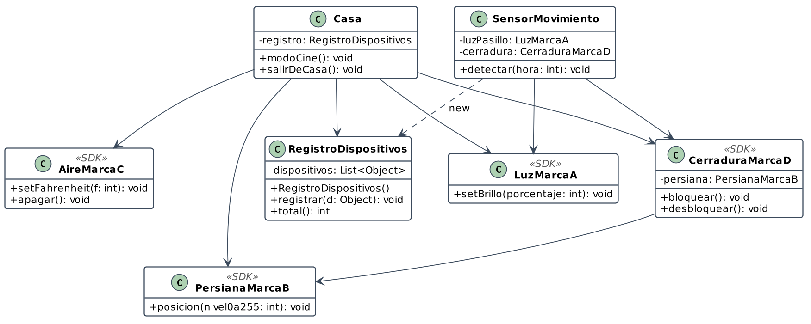

# Caso 05. Hogar inteligente: central de automatización

**Dominio:** Internet de las cosas (IoT)  
**Código inicial:** [`src/main/java/edu/ingsoft/actividad/comportamiento/caso05/`](../../src/main/java/edu/ingsoft/actividad/comportamiento/caso05/)

## 1. Contexto de la aplicación

«CasaClara» es una central de automatización para viviendas. Controla luces, persianas, aire acondicionado, cerraduras y un sensor de movimiento de distintos fabricantes; cada fabricante ofrece su propio SDK con métodos y unidades diferentes (porcentajes, niveles de 0 a 255, grados Fahrenheit).

Los usuarios configuran «escenas» (por ejemplo, «Modo cine»: luces al 20 %, persianas cerradas, aire a 22 °C) y esperan poder deshacerlas. Además, los dispositivos reaccionan entre sí: si el sensor detecta movimiento de noche se encienden las luces del pasillo, y si se activa el modo «Salir de casa» se cierran persianas y cerradura y se apaga el aire.

## 2. Problemática

Cada clase de dispositivo conoce y manipula directamente a otros dispositivos para reaccionar a eventos (el sensor tiene referencias a las luces y a la cerradura, la cerradura a las persianas). Las escenas se implementan como métodos largos en la clase Casa que llaman a los SDK con sus unidades propias, sin posibilidad de deshacerlas. En varias clases se crea con new un nuevo registro de dispositivos y quedan desincronizados.

### Lo que reporta el equipo de desarrollo

- «Agregar un detector de humo obliga a modificar el sensor, las luces y la cerradura.»
- «No hay forma de deshacer el Modo cine; el usuario tiene que ajustar todo a mano.»
- «Las persianas de la marca B usan 0–255 y la escena las dejó a medio cerrar porque se envió 100.»
- «La app ve 5 dispositivos y la central ve 4: cada una tiene su propio registro.»

## 3. Diagrama de clases inicial



> Fuente editable: [`diagrama-inicial.puml`](diagrama-inicial.puml) (PlantUML).

## 4. Código inicial

| Archivo | Ubicación |
|---|---|
| `RegistroDispositivos.java` | [`src/main/java/edu/ingsoft/actividad/comportamiento/caso05/RegistroDispositivos.java`](../../src/main/java/edu/ingsoft/actividad/comportamiento/caso05/RegistroDispositivos.java) |
| `LuzMarcaA.java` | [`src/main/java/edu/ingsoft/actividad/comportamiento/caso05/LuzMarcaA.java`](../../src/main/java/edu/ingsoft/actividad/comportamiento/caso05/LuzMarcaA.java) |
| `PersianaMarcaB.java` | [`src/main/java/edu/ingsoft/actividad/comportamiento/caso05/PersianaMarcaB.java`](../../src/main/java/edu/ingsoft/actividad/comportamiento/caso05/PersianaMarcaB.java) |
| `AireMarcaC.java` | [`src/main/java/edu/ingsoft/actividad/comportamiento/caso05/AireMarcaC.java`](../../src/main/java/edu/ingsoft/actividad/comportamiento/caso05/AireMarcaC.java) |
| `CerraduraMarcaD.java` | [`src/main/java/edu/ingsoft/actividad/comportamiento/caso05/CerraduraMarcaD.java`](../../src/main/java/edu/ingsoft/actividad/comportamiento/caso05/CerraduraMarcaD.java) |
| `SensorMovimiento.java` | [`src/main/java/edu/ingsoft/actividad/comportamiento/caso05/SensorMovimiento.java`](../../src/main/java/edu/ingsoft/actividad/comportamiento/caso05/SensorMovimiento.java) |
| `Casa.java` | [`src/main/java/edu/ingsoft/actividad/comportamiento/caso05/Casa.java`](../../src/main/java/edu/ingsoft/actividad/comportamiento/caso05/Casa.java) |
| `Demo.java` | [`src/main/java/edu/ingsoft/actividad/comportamiento/caso05/Demo.java`](../../src/main/java/edu/ingsoft/actividad/comportamiento/caso05/Demo.java) |

Ejecutar el escenario actual:

```bash
scripts/ejecutar.sh caso05
```

Salida actual (también en [`salida-esperada.txt`](salida-esperada.txt)):

```text
 escena: modo cine
  luz sala -> 20%
  persiana -> nivel 100/255
  aire -> 72 °F
 (no hay forma de deshacer el modo cine)
 sensor: movimiento a las 23h
  luz pasillo -> 40%
  cerradura -> bloqueada
  persiana -> nivel 255/255
 escena: salir de casa
  luz sala -> 0%
  luz pasillo -> 0%
  aire -> apagado
  cerradura -> bloqueada
  persiana -> nivel 255/255
Dispositivos en el registro de la casa: 4 (hay 6 instalados)
```

## 5. Nuevos requerimientos del negocio

Después de refactorizar, el diseño debe permitir incorporar los siguientes cambios. Impleméntelos y demuéstrelos en una clase `DemoNuevosRequerimientos`:

1. Agregar un detector de humo que, al activarse, abra la cerradura y las persianas y encienda todas las luces, sin modificar las clases de los demás dispositivos.
2. Permitir crear escenas nuevas por configuración y deshacer la última escena aplicada.
3. Integrar dispositivos de un nuevo fabricante sin cambiar las escenas ni las reglas de interacción.
4. Garantizar un único registro de dispositivos compartido por la central y la app.

## 6. Preguntas orientadoras

1. ¿Quién debería conocer las reglas de interacción entre dispositivos?
2. ¿Cómo representaría una escena para poder aplicarla, deshacerla y crearla por configuración?
3. ¿Qué interfaz común necesitan las escenas para hablar con dispositivos de distintos fabricantes?
4. ¿Cuántos registros de dispositivos deberían existir y quién debería crearlos?

## 7. Entregables del caso

1. Informe `casos/caso-05-hogar-inteligente/INFORME.md` diligenciado a partir de [`PLANTILLA_INFORME.md`](../../PLANTILLA_INFORME.md).
2. Diagrama de clases de la solución en `casos/caso-05-hogar-inteligente/diagrama-solucion.puml` (y su PNG).
3. Código refactorizado en el paquete `edu.ingsoft.actividad.comportamiento.caso05.solucion`, conservando el comportamiento correcto de `Demo` (verificable con `scripts/verificar.sh`; documente las diferencias que se deban a defectos corregidos).
4. Clase `DemoNuevosRequerimientos` que evidencie los cambios de la sección 5.

[← Volver a la actividad](../../README.md)
